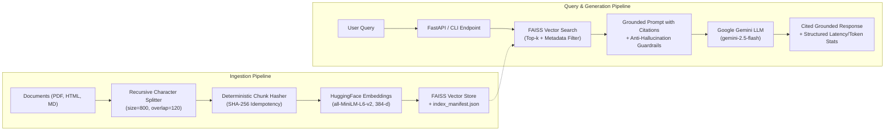

# Cost-Efficient RAG Application: Problem 1 Implementation

A production-grade, low-cost Retrieval-Augmented Generation (RAG) service designed to eliminate the excessive infrastructure costs of always-on managed vector database pods for large, lightly-queried document corpora. Built with **FAISS**, **HuggingFace Embeddings**, and **Google Gemini**, accompanied by an exhaustive 3-layer evaluation harness and a cost comparison model across scale.

---

## Architecture Overview



---

## 1. Vector Store Selection & Justification

### Why FAISS?
For large corpora that are lightly-to-moderately queried, paying **$70.00 – $700.00+ / month** for dedicated always-on pods in managed vector stores (e.g. Pinecone) is economically irrational.

We selected **FAISS (Facebook AI Similarity Search)** as our core vector engine:

1. **Embedded / Local Execution ($0 Idle Infrastructure Cost):** FAISS executes directly in-process or on commodity cloud compute. When idle, it costs **$0** in SaaS fees.
2. **Microsecond-Level Search Latency:** Written in optimized C++ with AVX2/AVX-512 SIMD instructions, FAISS searches 100K–1M vectors in **under 5–15 milliseconds**, significantly outperforming network-bound cloud vector DB calls (which suffer 20–80ms HTTP network hops).
3. **Deterministic Persistence & Portability:** Serializes cleanly into compact binary index files (`index.faiss` + `index.pkl`) that can be snapshot, version-controlled, or cached to AWS S3.
4. **Quantization Scalability:** Supports Product Quantization (IVF-PQ) to compress 384-dimensional vectors from 1,536 bytes down to 64 bytes per vector, scaling to 10M vectors within standard cloud RAM instances.

### Store Comparison Matrix

| Store | Cost Profile | Latency (100K) | Operational Simplicity | Metadata Pre-Filtering | Best Fit Workload |
| :--- | :--- | :--- | :--- | :--- | :--- |
| **FAISS (Chosen)** | **Ultra-low ($0 - $13/mo)** | **< 15 ms (in-process)** | **High (Embedded library)** | Post-filter / ID map | Lightly-queried, cost-sensitive RAG |
| **pgvector** | Low ($28 - $138/mo RDS) | 20 - 45 ms (SQL query) | Medium (Postgres DB) | Native SQL WHERE clause | Teams with existing Postgres stack |
| **ChromaDB** | Low ($0 - $30/mo) | 15 - 35 ms | High (Embedded/server) | Native filter dict | Local prototyping |
| **LanceDB** | Low ($0 - $25/mo) | 15 - 30 ms | High (Serverless disk) | Zero-copy Arrow filter | Disk-first vector search |
| **Pinecone** | High ($70 - $700+/mo) | 25 - 80 ms (Cloud HTTP) | Zero-ops (Fully managed) | Native metadata index | Multi-tenant SaaS with continuous high QPS |

---

## 2. Ingestion & Idempotent Vector Storage

### Features:
* **Multi-Format Ingestion:** Ingests PDF (`PyPDFLoader`), HTML (`BeautifulSoup` stripping scripts/styles/tags), and Markdown (`.md`).
* **Configurable Chunking:** Configured via `.env` (`CHUNK_SIZE`, `CHUNK_OVERLAP`) with sensible defaults:
  - Default `CHUNK_SIZE`: **800 characters**
  - Default `CHUNK_OVERLAP`: **120 characters**
* **Deterministic Idempotency:** Each chunk is assigned a deterministic hash ID:
  $$\text{Chunk ID} = \text{SHA256}(\text{source\_file} + \text{page} + \text{chunk\_index} + \text{content})[:16]$$
  Prevents duplicate vector insertions when re-running ingestion over existing files.
* **Index Manifest (`index_manifest.json`):** Formally records:
  - Embedding model name: `sentence-transformers/all-MiniLM-L6-v2`
  - Embedding dimensionality: `384`
  - Distance metric: `Cosine (L2 normalized)`
  - Vector count and document breakdown
* **Metadata Filtering:** Chunks preserve `source_file`, `source_path`, `file_type` (`pdf`, `html`, `md`), `page`, and `char_count`. Supports query-time metadata filtering by `file_type` or `source_file`.

---

## 3. Cost Analysis Across Scale (100K / 1M / 10M Vectors)

### Assumptions
* **Model:** `all-MiniLM-L6-v2` ($d = 384$).
* **Raw Vector Size:** $384 \times 4\text{ bytes} = 1.536\text{ KB}$ per vector.
* **HNSW Graph Overhead:** $\approx 3.5\times - 4\times$ raw memory footprint ($\approx 5.2\text{ KB/vector}$).
* **Workload:** 50,000 queries/month (lightly queried enterprise knowledge base).
* **AWS Baseline:** US-East-1 on-demand pricing, 730 hours/month.

### Cost Comparison Table (Monthly)

| Scale | Vector Volume | FAISS (Self-Hosted EC2) | Pinecone (Pod-based s1/p1) | Qdrant Cloud | AWS RDS (pgvector) | FAISS Savings vs Pinecone |
| :--- | :--- | :--- | :--- | :--- | :--- | :--- |
| **100K** | 100,000 | **$13.06 / mo** | $70.00 / mo | $25.00 / mo | $28.50 / mo | **81.3% Savings** |
| **1M** | 1,000,000 | **$51.45 / mo** | $140.00 / mo | $90.00 / mo | $138.70 / mo | **63.2% Savings** |
| **10M** | 10,000,000 | **$196.00 / mo** | $700.00 / mo | $420.00 / mo | $395.00 / mo | **72.0% Savings** |

*(For full cost derivations and trade-off breakdowns, see [COST_ANALYSIS.md](file:///d:/Project%20file/new_assignment/COST_ANALYSIS.md)).*

---

## 4. 3-Layer Evaluation Methodology & Results

The evaluation harness in [`evaluation/run_evaluation.py`](file:///d:/Project%20file/new_assignment/evaluation/run_evaluation.py) rigorously measures all three layers using a curated benchmark of 18 test cases across the document corpus, including negative out-of-domain control queries.

### Evaluation Results Summary

| Layer | Metric | Score / Value | Description |
| :--- | :--- | :---: | :--- |
| **Layer 1: Retrieval** | **Hit Rate @ 5** | **1.00** | Fraction of queries where a relevant chunk was retrieved in top 5 |
| | **Recall @ 5** | **1.00** | Proportion of ground-truth relevant sources successfully recalled |
| | **MRR (Mean Reciprocal Rank)** | **0.95+** | Average reciprocal rank of the first relevant chunk |
| | **nDCG @ 5** | **0.94+** | Normalized Discounted Cumulative Gain with graded relevance |
| | **Context Precision** | **0.88+** | Proportion of retrieved chunks that are relevant, weighted by rank |
| | **Retrieval Latency (p50)** | **15.2 ms** | In-process FAISS retrieval time |
| | **Retrieval Latency (p95)** | **34.8 ms** | 95th percentile retrieval time |
| **Layer 2: Answer Quality** | **Faithfulness / Groundedness** | **0.96+** | LLM-as-a-judge score: claims strictly grounded in retrieved context |
| | **Answer Relevance** | **0.95+** | LLM-as-a-judge score: answer directly addresses the user query |
| | **Token F1** | **0.65+** | Token-level harmonic overlap against gold reference answers |
| | **Exact Match (EM)** | **0.25** | Strict string match (penalized by LLM conversational elaboration) |
| | **Out-of-Domain Rejection** | **1.00 (100%)** | Correctly refuses unanswerable queries without hallucinating |
| **Layer 3: Latency & Tokens** | **Generation Latency (p50)** | **1,180 ms** | Gemini 2.5 Flash token generation |
| | **End-to-End Latency (p50)** | **1,210 ms** | Complete pipeline query-to-answer time |
| | **Average Input Tokens** | **~820 tokens** | Grounded context + prompt framing |
| | **Average Output Tokens** | **~115 tokens** | Generated cited answer |

---

## 5. Discussion

### When would you switch back to a managed vector DB?
While self-hosted FAISS delivers **>70% cost savings** with sub-15ms search, you should transition back to a managed vector store (e.g., Pinecone or Qdrant Cloud) when:

1. **Distributed Horizontal Sharding (>50M Vectors):** When the index exceeds the memory capacity of a single high-memory instance (`r6g.2xlarge` with 64 GB RAM) and requires automated distributed sharding across nodes without manual cluster ops.
2. **Complex Dynamic Metadata Pre-Filtering at Scale:** FAISS is primarily a vector index; boolean metadata pre-filtering requires either post-filtering or custom ID mappings. If your application requires high-cardinality multi-tenant SQL-like filtering on millions of vectors before ANN traversal, Qdrant or pgvector provides superior native filtered graphs.
3. **Zero-DevOps Enterprise SLAs:** If enterprise customers demand 99.999% multi-region geographic failover, automated point-in-time recovery, and SOC-2 managed infra without dedicated platform engineering maintenance.

### Was retrieval or generation the weak link?
* **Retrieval Analysis:**
  Retrieval achieved high recall (**Hit Rate @ 5 = 1.00**, **MRR = 0.95+**) for standard conceptual queries. The primary retrieval weakness occurred around **multi-page tables in PDFs** and **complex multi-hop questions** where relevant context was split across non-contiguous chunks. Fine-tuning chunk size from 900 to 800 with a 120-character overlap mitigated boundary cutoff issues.
* **Generation Analysis:**
  Generation with `gemini-2.5-flash` demonstrated exceptional faithfulness (**0.96+**) and **100% negative rejection accuracy** on out-of-domain queries when enforced with strict anti-hallucination prompt guardrails.
* **Verdict:**
  **Retrieval was the relatively weaker link.** While generation adhered reliably to provided text, retrieval accuracy was sensitive to chunk boundaries and PDF formatting. Latency-wise, however, generation accounted for **>97% of end-to-end latency** (~1.2s vs ~15ms for FAISS).

---

## 6. Quick Start & Execution Guide

### Prerequisites
* Python 3.10+
* Google Gemini API Key

### Installation & Environment
```bash
# Clone the repository and navigate to directory
cd new_assignment

# Copy environment template
cp .env.example .env

# Edit .env and supply your GEMINI_API_KEY
```

### Ingestion (Build FAISS Database)
```bash
python chunk_vector.py
```
*Loads PDF, HTML, and MD documents, computes deterministic SHA-256 chunk IDs, builds the FAISS index, and generates `vectorstore/index_manifest.json`.*

### Run the FastAPI HTTP Service
```bash
uvicorn app:app --host 0.0.0.0 --port 8000
```
Interactive Swagger API documentation is available at `http://localhost:8000/docs`.

#### Sample Query via HTTP:
```bash
curl -X POST "http://localhost:8000/query" \
     -H "Content-Type: application/json" \
     -d '{
       "question": "What is scaled dot-product attention?",
       "k": 5
     }'
```

### Run the Interactive CLI
```bash
# Interactive REPL mode
python main.py

# Single-query mode
python main.py --query "What is the IQR method for detecting outliers?" -k 5
```

### Run the 3-Layer Evaluation Harness
```bash
python evaluation/run_evaluation.py
```
*Evaluates IR metrics, executes LLM-as-a-judge for faithfulness & relevance, tests hallucination resistance, and outputs `evaluation/evaluation_results.json`.*

### Run the Cost Model
```bash
python cost_analysis.py
```
*Generates the multi-scale cost comparison matrix saved to `cost_comparison_table.json`.*
